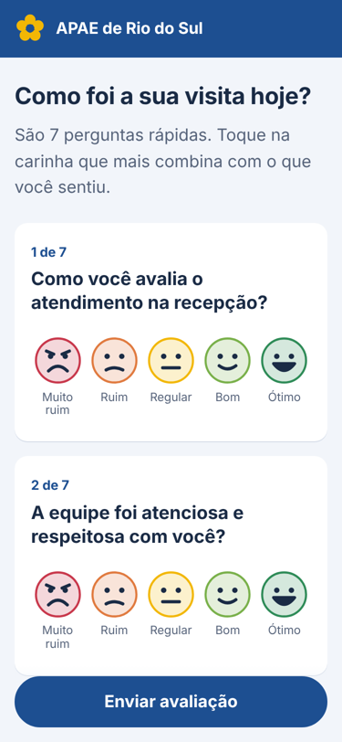
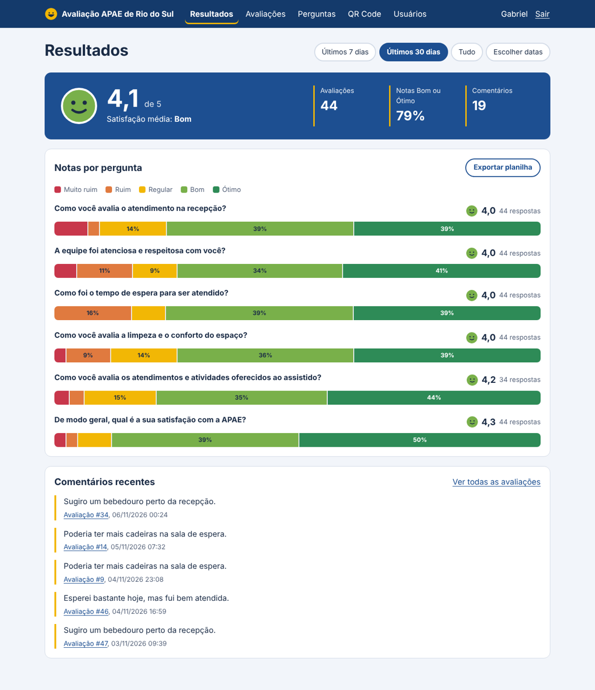

# Questionário de Avaliação · APAE de Rio do Sul

Sistema web para a **APAE de Rio do Sul (SC)** coletar, de forma anônima, a avaliação de familiares, responsáveis e visitantes sobre o atendimento.
Na recepção fica um **cartaz com QR Code**: a pessoa aponta o celular, responde tocando em carinhas, e a equipe acompanha os resultados num painel protegido por senha.

Projeto de Extensão · Sistemas de Informação · Unidavi · Programação Web I

**Documento de requisitos:** [`docs/requisitos.md`](docs/requisitos.md)

<p>
  
  
</p>

## Funcionalidades

| Para quem | O que faz |
|---|---|
| Público (sem login) | Questionário anônimo com carinhas de 1 a 5 e comentário; modo totem para tablet na recepção |
| Equipe (com login) | Painel com média, % de notas positivas e distribuição por pergunta, com filtro por período |
| | Lista e detalhe das avaliações, exclusão de testes e exportação para Excel (CSV) |
| | Cadastro, edição, ordenação e ativação de perguntas |
| | Cartaz A4 com QR Code para imprimir |
| | Cadastro de usuários e troca de senha |

## Tecnologias

- PHP 8.1+ sem framework, com PDO
- PostgreSQL 13+
- HTML, CSS e JavaScript puros
- [qrcode-generator](https://github.com/kazuhikoarase/qrcode-generator) (licença MIT) em `public/assets/vendor/`
- Docker para publicação

## Segurança e privacidade

- Consultas parametrizadas (SQL Injection) e saída escapada com `htmlspecialchars` (XSS)
- Token CSRF em todos os formulários que alteram dados
- Senhas com `password_hash`; sessão com `HttpOnly`, `SameSite` e regeneração de ID no login
- Bloqueio de login após 5 tentativas erradas em 15 minutos
- Questionário anônimo: não grava nome, contato nem IP (LGPD)

## Como rodar no Windows (XAMPP)

1. Instale o **PostgreSQL** (<https://www.postgresql.org/download/windows/>) e anote a senha do usuário `postgres`.
2. No `C:\xampp\php\php.ini`, apague o `;` do começo das linhas `extension=pdo_pgsql` e `extension=pgsql`.
3. Dê dois cliques em **`iniciar.bat`**. Na primeira vez ele abre o arquivo `.env`: coloque a senha do PostgreSQL em `DB_PASSWORD=`, salve e rode o `iniciar.bat` de novo.
4. Questionário: <http://localhost:8080> · Área da equipe: <http://localhost:8080/admin/> (login definido em `ADMIN_EMAIL` e `ADMIN_SENHA` no `.env`).

O banco, as tabelas, as perguntas padrão e o primeiro administrador são criados automaticamente pelo `scripts/migrate.php`.

### Linux / macOS

```bash
cp .env.example .env        # ajuste os dados do banco e do administrador
php scripts/migrate.php
php -S localhost:8080 -t public
```

## Publicação (Render + Neon)

1. **Neon** (<https://neon.com>): crie um projeto na região *AWS US East 1* e copie a connection string **sem** connection pooling.
2. **Render** (<https://render.com>): *New → Blueprint*, escolha este repositório. O `render.yaml` já define Docker, plano gratuito e região. Preencha:
   - `DATABASE_URL`: a connection string do Neon
   - `ADMIN_EMAIL` e `ADMIN_SENHA`: o primeiro administrador
   - `APP_URL`: o endereço gerado pelo Render (ex.: `https://apae-avaliacao.onrender.com`), usado no QR Code
3. Depois do deploy, entre em `/admin/`, troque a senha em **Minha conta** e imprima o cartaz em **QR Code**.

> No plano gratuito, o Render suspende o site após 15 minutos sem acesso, e o primeiro acesso seguinte leva cerca de 1 minuto.
> Um monitor gratuito (ex.: UptimeRobot) acessando `/saude.php` a cada 10 minutos mantém o site ativo.

### Variáveis de ambiente

| Variável | Para que serve |
|---|---|
| `DATABASE_URL` | Conexão completa com o PostgreSQL (tem prioridade sobre `DB_*`) |
| `DB_HOST`, `DB_PORT`, `DB_NAME`, `DB_USER`, `DB_PASSWORD` | Conexão em partes (uso local) |
| `APP_URL` | Endereço público usado no QR Code |
| `APP_NOME` | Nome exibido (padrão: APAE de Rio do Sul) |
| `APP_ENV` | `production` esconde detalhes técnicos dos erros |
| `ADMIN_NOME`, `ADMIN_EMAIL`, `ADMIN_SENHA` | Primeiro administrador (criado só se não houver usuários) |
| `TRUST_PROXY` | `1` atrás de proxy (Render), para o limite de login usar o IP real |

## Logotipo

Coloque o logo oficial (com autorização da APAE) em `public/assets/img/logo.png`. Ele aparece automaticamente no topo do questionário.

## Estrutura

```text
public/       única pasta acessível pela web (questionário, área admin, CSS, JS)
src/          classes PHP, autenticação, funções auxiliares e templates
database/     criação das tabelas e perguntas padrão
scripts/      instalação do banco (migrate.php)
docker/       inicialização do contêiner e detecção do PHP no Windows
docs/         documento de requisitos e imagens
```

## Equipe

- _Nome do integrante 1_
- _Nome do integrante 2_

Unidavi · 2026
