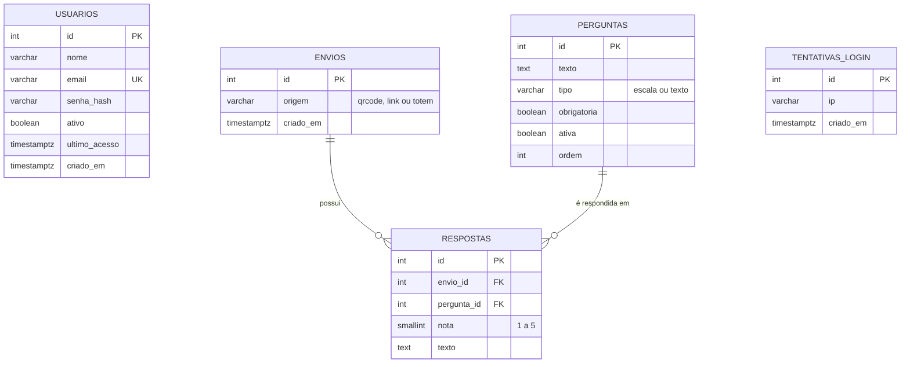

# Documento de Requisitos — Questionário de Avaliação da APAE de Rio do Sul

Projeto de Extensão do curso de Sistemas de Informação (Unidavi), disciplina de Programação Web I.
Programas de extensão vinculados: **Desenvolvimento e Cidadania** e **Universidade Solidária**.

## 1. Problema

A APAE de Rio do Sul não tem um canal simples e contínuo para que familiares, responsáveis e visitantes avaliem o atendimento.
Hoje a percepção de qualidade chega de forma informal (conversas e reclamações pontuais), sem registro, sem histórico
e sem números que apoiem as decisões da gestão ou os relatórios a parceiros e financiadores.

## 2. Solução

Um sistema web com duas partes:

1. **Questionário público e anônimo**, acessado pelo celular por um QR Code exposto na recepção.
2. **Área administrativa com login**, onde a equipe cadastra as perguntas, acompanha os resultados e imprime o cartaz com o QR Code.

## 3. Atores

| Ator | Descrição |
|---|---|
| Respondente | Familiar, responsável, visitante ou usuário da APAE. Não se identifica. |
| Administrador | Colaborador da APAE (recepção, coordenação, direção) com e-mail e senha. |

## 4. Histórias de usuário e critérios de aceitação

### US1 — Responder ao questionário pelo celular (prioridade alta)
Como respondente, quero ler o QR Code na recepção e avaliar o atendimento tocando em carinhas, para dar minha opinião de forma rápida e anônima.

- As perguntas ativas aparecem na ordem definida pela equipe.
- Ao tocar em uma carinha, a opção fica destacada e o rótulo em texto aparece ("Bom", por exemplo).
- Pergunta obrigatória sem resposta: o formulário volta com a mensagem junto à pergunta, mantendo as demais respostas.
- Envio válido: as respostas são gravadas e aparece a tela de agradecimento.
- Dois toques em "Enviar" gravam apenas uma avaliação.
- Sem perguntas ativas: aparece "O questionário está em atualização."

### US2 — Entrar e sair da área administrativa (prioridade alta)
Como administrador, quero entrar com e-mail e senha, para acessar as funções restritas.

- Qualquer página de `/admin/` sem login redireciona para a tela de entrada.
- Credenciais inválidas mostram "E-mail ou senha incorretos.", sem indicar qual dos dois está errado.
- Após 5 tentativas erradas do mesmo IP em 15 minutos, o login fica bloqueado temporariamente.
- "Sair" encerra a sessão.

### US3 — Cadastrar e organizar perguntas (prioridade média)
Como administrador, quero criar, editar, ordenar, ativar/desativar e excluir perguntas, para adaptar a avaliação sem depender de programador.

- Nova pergunta (texto, tipo e obrigatoriedade) vai para o fim da lista.
- Mover para cima/baixo altera a ordem no questionário.
- Pergunta desativada some do questionário, mas suas respostas continuam nos relatórios.
- Pergunta com respostas não pode ser excluída nem ter o tipo alterado.

### US4 — Visualizar os resultados (prioridade média)
Como administrador, quero ver um resumo das avaliações e cada resposta, para identificar pontos fortes e de melhoria.

- Painel com total de avaliações, satisfação média, percentual de notas Bom/Ótimo e quantidade de comentários.
- Por pergunta: média, número de respostas e distribuição das notas de 1 a 5.
- Filtro por período: 7 dias, 30 dias, tudo ou datas escolhidas.
- Lista paginada de avaliações e detalhe de cada uma, com opção de excluir (testes ou spam).
- Exportação em planilha CSV que abre corretamente no Excel.

### US5 — Gerar o cartaz com QR Code (prioridade baixa)
Como administrador, quero imprimir um cartaz com o QR Code do questionário, para colocar na recepção.

- O QR Code aponta para o endereço público com `?origem=qrcode`.
- "Imprimir cartaz" gera uma folha A4 sem menus do sistema.
- "Baixar imagem" entrega o QR Code em PNG.

### US6 — Gerenciar usuários (prioridade baixa)
Como administrador, quero cadastrar colegas e trocar minha senha, para não compartilhar uma senha única.

- Cadastro com nome, e-mail e senha inicial (mínimo 8 caracteres).
- Usuário desativado não consegue mais entrar; ninguém pode desativar o próprio acesso.
- Troca de senha exige a senha atual.

## 5. Requisitos funcionais

| ID | Requisito | História |
|---|---|---|
| RF01 | Exibir as perguntas ativas na ordem definida. | US1 |
| RF02 | Suportar dois tipos de pergunta: escala de 1 a 5 (carinhas com rótulo) e texto livre. | US1, US3 |
| RF03 | Validar no servidor a obrigatoriedade, o intervalo da nota e o tamanho do texto (máx. 1.000 caracteres). | US1 |
| RF04 | Gravar cada avaliação de forma atômica (transação). | US1 |
| RF05 | Impedir envio duplicado. | US1 |
| RF06 | Não gravar dados pessoais nem IP do respondente. | US1 |
| RF07 | Registrar a origem da avaliação (QR Code, link ou tablet). | US1, US4 |
| RF08 | Oferecer modo totem (`?modo=totem`) que volta ao início 10 s após o agradecimento. | US1 |
| RF09 | Autenticar administradores por e-mail e senha criptografada. | US2 |
| RF10 | Bloquear o login após 5 falhas do mesmo IP em 15 minutos. | US2 |
| RF11 | Proteger contra CSRF todos os formulários que alteram dados. | Todas |
| RF12 | Permitir cadastro, edição, reordenação, ativação/desativação e exclusão de perguntas. | US3 |
| RF13 | Não permitir excluir pergunta com respostas nem alterar seu tipo. | US3 |
| RF14 | Apresentar indicadores e distribuição de notas filtráveis por período. | US4 |
| RF15 | Listar avaliações com paginação (20 por página) e exibir o detalhe. | US4 |
| RF16 | Exportar avaliações do período em CSV compatível com Excel. | US4 |
| RF17 | Gerar QR Code do endereço público e cartaz A4 para impressão. | US5 |
| RF18 | Permitir cadastrar e desativar usuários e trocar a própria senha. | US6 |
| RF19 | Criar as tabelas e o administrador inicial por script de instalação. | Implantação |

## 6. Requisitos não funcionais

| ID | Requisito |
|---|---|
| RNF01 | Interface responsiva, utilizável a partir de 360 px de largura (celular). |
| RNF02 | Acessibilidade WCAG 2.1 AA: contraste, foco visível, rótulos em texto, navegação por teclado. |
| RNF03 | Questionário respondido em menos de 2 minutos. |
| RNF04 | PHP 8.1+ e PostgreSQL 13+, sem framework. |
| RNF05 | Configuração por variáveis de ambiente; nenhuma senha no repositório. |
| RNF06 | Consultas parametrizadas (SQL Injection) e saída escapada (XSS). |
| RNF07 | Conformidade com a LGPD: questionário anônimo. |

## 7. Modelo de dados

- Um **envio** é uma avaliação completa; ele não guarda IP nem dados pessoais.
- Excluir um envio exclui suas respostas (`ON DELETE CASCADE`).
- Uma pergunta com respostas não pode ser excluída (`ON DELETE RESTRICT`).
- Script completo: [`database/schema.sql`](../database/schema.sql).

### Perguntas padrão (a validar com a APAE)

| Ordem | Pergunta | Tipo | Obrigatória |
|---|---|---|---|
| 1 | Como você avalia o atendimento na recepção? | escala | sim |
| 2 | A equipe foi atenciosa e respeitosa com você? | escala | sim |
| 3 | Como foi o tempo de espera para ser atendido? | escala | sim |
| 4 | Como você avalia a limpeza e o conforto do espaço? | escala | sim |
| 5 | Como você avalia os atendimentos e atividades oferecidos ao assistido? | escala | não |
| 6 | De modo geral, qual é a sua satisfação com a APAE? | escala | sim |
| 7 | Quer deixar um elogio, sugestão ou crítica? | texto | não |

## 8. Fora do escopo desta versão

- Perguntas de múltipla escolha.
- Vários questionários ao mesmo tempo (por exemplo, um por setor).
- Níveis de permissão diferentes entre administradores.
- Recuperação de senha por e-mail.

## 9. Pendências com a entidade

- Validar o texto das perguntas padrão com a coordenação.
- Obter o logotipo oficial e a autorização de uso.
- Definir os administradores iniciais.
- Definir o local do cartaz e se haverá tablet na recepção.
